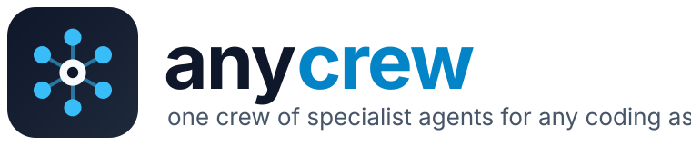
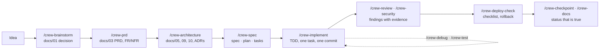

<p align="center">
  
</p>

<p align="center">
  <strong>One crew of specialist AI agents for any coding assistant.</strong><br>
  Spec-driven · test-first · security-reviewed · model-tiered
</p>

<p align="center">
  <a href="https://github.com/fadlytanjung/anycrew/actions/workflows/ci.yml"></a>
  <a href="https://www.npmjs.com/package/anycrew"></a>
  <a href="https://pypi.org/project/anycrew/"></a>
  
  
  
  <a href="LICENSE"></a>
  <br>
  
  
  
  
  
  
</p>

---

anycrew installs a ready-made engineering team into the coding assistant you already use. Seventeen
agents (brainstormer, product manager, architect, designer, spec writer, implementer, tester,
quality engineer, reviewer, security reviewer, debugger, AI engineer, release engineer, doc writer,
scout, crew lead)
follow one method from idea to a deployed MVP, and leave behind the documents a team can review: a
constitution, a PRD, ADRs, specs with acceptance criteria, and a status page that says what is
really built. Each agent declares how much model it needs, so cheap work runs on cheap models.

```bash
uvx anycrew init            # Python: uv (or `pipx run anycrew init`, or `pip install anycrew`)
npx anycrew init            # Node: npm
```

Both CLIs are the same tool: one canonical pack, two zero-dependency ports that generate
byte-identical projects (the CI proves it on every commit). Use whichever runtime you already have.

> **Status: 0.1.0, early.** Published on [PyPI](https://pypi.org/project/anycrew/) and
> [npm](https://www.npmjs.com/package/anycrew). Claude Code and Antigravity outputs are verified end
> to end; Codex, Cursor, OpenCode and Copilot outputs follow their documentation and are being
> exercised next. See the [tool matrix](docs/04-tool-matrix.md). Feedback and PRs welcome.

## Contents

- [Why anycrew](#why-anycrew)
- [Concepts in two minutes](#concepts-in-two-minutes)
- [What you get](#what-you-get)
- [Quick start](#quick-start)
- [Install the pack globally](#install-the-pack-globally)
- [How it works](#how-it-works)
- [The crew](#the-crew)
- [Model tiers](#model-tiers)
- [What `init` writes](#what-init-writes)
- [Documentation and wiki](#documentation-and-wiki)
- [FAQ](#faq)
- [Roadmap](#roadmap)
- [Contributing](#contributing)
- [Acknowledgements](#acknowledgements)
- [Licence](#licence)

## Why anycrew

Every new project with a coding assistant repeats the same setup: an agent guide, rules, a handful
of slash commands, a constitution, a docs skeleton, a spec loop, quality gates, a status page. Each
assistant wants those in a different folder with a different front matter. The packs that exist are
tied to one assistant, or ship skills without a team, or ship a method without the security,
testing, docs and release roles an MVP needs. None of them says which model each role needs.

anycrew is the boilerplate for the **team**, not for the stack. A preset describes your stack's
commands and conventions; anycrew never forces a framework, a cloud or a language.

## Concepts in two minutes

Every term has a page in the [wiki](wiki/Home.md). The short version:

| Term | Means | In anycrew |
|---|---|---|
| **SDD** (spec-driven development) | write and approve the spec first, implement from it, change both together | the whole method; `rules/00-sdd-process.md` |
| **Constitution** | the short list of principles every change is checked against | `docs/00-constitution.md`, created by `init` |
| **PRD** (product requirements document) | who it is for, what they need, scope by priority, requirements with IDs | `docs/03`, written by `/crew-prd` |
| **ADR** (architecture decision record) | one decision that is expensive to reverse: context, options, decision, consequences | `docs/adr/ADR-NNN-*.md`, written by `/crew-adr` |
| **AC** (acceptance criterion) | one testable Given/When/Then statement, `AC-NNN-n` | in every spec; test names and commits cite them |
| **Spec · plan · tasks** | what and why · how and which files · ordered test-first checklist | `docs/specs/NNN-name/`, the unit of work |
| **Implementation status** | the only doc that says what is actually built, with the test that proves it | `docs/20`, kept true by `/crew-checkpoint` |
| **Gate** | a point where a person decides before the next phase | decision, P0 scope, ADRs, spec Ready, production deploy |
| **Agent** | a specialist with its own prompt, tools and model the assistant delegates to | 17 in `agents/` |
| **Skill** | a procedure loaded on demand, typed as `/name` | 24 `/crew-*` in `skills/` |
| **Rule** | always-on or path-scoped guidance | 6 in `rules/`, plus stack rules from your preset |
| **Tier** | how much model an agent needs: `fast`, `balanced`, `strong` | mapped per assistant in `models.json` |
| **Preset** | a JSON description of a stack: commands, layout, conventions | `presets/`, or your own file |
| **Hook** | a command the assistant runs at an event, e.g. after a file edit | lint-after-edit, wired into each assistant |
| **Architecture style** | the shape of the system: layered, hexagonal, clean, modular monolith, microservices, event-driven, CQRS, pipeline | asked at `init` (Proposed ADR-001), confirmed with `/crew-patterns` from a catalogue with choose/avoid columns |
| **Design pattern** | a named solution to a recurring design problem (factory, strategy, state, repository, outbox, …) | picked per problem with `/crew-patterns`; recorded in `docs/13` so every implementer uses the same one |
| **Code smell** | a symptom that makes code expensive to change (long function, feature envy, float money, prompt in code, …) | found and refactored one commit at a time with `/crew-refactor` |

## What you get

| | |
|---|---|
| **17 agents** | each with a job, inputs, outputs, a procedure, rules, stop conditions and a **model tier** |
| **24 skills** (`/crew-*`) | the workflow as slash commands: status, brainstorm, research, prd, architecture, **patterns**, adr, design, spec, plan, tasks, implement, test, **refactor**, review, security, verify, debug, checkpoint, deploy-check, docs, llm, sync, init |
| **6 rules** | spec-driven process, architecture boundaries, security and data, LLM features, testing, docs and status; plus backend and frontend rules generated from your preset |
| **Docs skeleton** | constitution, brainstorm, research, PRD, traceability, architecture, data model, API, frontend, design system, conventions, security, testing, infra, observability, delivery plan, status, ADRs, specs |
| **Presets** | `python-fastapi-react`, `node-typescript-next`, `go-service`, `generic`; write your own in one JSON file |
| **Hook** | a tool-agnostic lint-after-edit hook wired into each assistant |
| **One CLI, two runtimes** | `uvx anycrew init` (Python) or `npx anycrew init` (Node) generates every assistant's native files from one source; `sync` keeps them current without touching your edits; zero dependencies in both |

## Quick start

```bash
cd your-project
uvx anycrew init --preset python-fastapi-react --tools claude,codex,antigravity
# or just:  uvx anycrew init     (detects the assistants on your machine)
# Node users: replace `uvx anycrew` with `npx anycrew` in every command below

uvx anycrew doctor      # what each assistant will read
uvx anycrew list        # agents, tiers and the model each assistant will use
```

In a terminal, `init` asks four things: which assistants (default: the ones it detects, usually one
or two), the stack preset, the project name and purpose, and the **architecture style** (modular
monolith with hexagonal modules by default, or layered, clean, microservices, event-driven, CQRS,
pipeline, serverless, or `undecided`). The style is recorded as a Proposed `docs/adr/ADR-001`;
`/crew-patterns` later confirms it against the real forces and picks the design patterns per problem.
`anycrew styles` lists the choices with when to choose and when to avoid each.

Then open your assistant in the folder and type `/crew-status`. For a new idea, `/crew-brainstorm`;
for an existing codebase, `/crew-spec`. Not sure which architecture or patterns fit? `/crew-patterns`.

## Install the pack globally

| Assistant | Command |
|---|---|
| Claude Code | `claude plugin marketplace add fadlytanjung/anycrew && claude plugin install anycrew@anycrew` |
| Antigravity | `agy plugin install https://github.com/fadlytanjung/anycrew` |
| Codex | `codex plugin marketplace add fadlytanjung/anycrew` then `/plugins` |
| Copilot CLI | `copilot plugin install fadlytanjung/anycrew` |
| Cursor | Customize → Install, point at the repository (Agent Plugins manifest) |
| Skills only, any assistant | `npx skills add fadlytanjung/anycrew` |
| Python environment | `pip install anycrew` or `uv tool install anycrew` gives you the `anycrew` command |

A global install gives you the agents and skills everywhere. `npx anycrew init` in a project adds
the docs skeleton, the stack rules, the hooks and the per-project model overrides.

## How it works



Each skill delegates to one agent at its tier. The crew lead sequences the phases and keeps a
person at every gate. Agents never approve their own work.

## The crew

| Agent | Tier | Does |
|---|---|---|
| crew-lead | strong | routes a request through the phases; never codes |
| scout | fast | finds what exists, read-only, before anyone guesses |
| brainstormer | strong | idea → problem scan → scored options → decision (`docs/01`) |
| researcher | balanced | facts with sources and confidence (`docs/02`) |
| product-manager | strong | personas, journeys, P0/P1/P2, FR/NFR (`docs/03`, `04`) |
| architect | strong | containers, boundaries, data model, API contract, ADRs |
| designer | balanced | screens, states, tokens, responsive and accessibility rules |
| ai-engineer | strong | model/code boundary, prompts as files, schemas, grounding, evals |
| spec-writer | strong | spec, plan, tasks with acceptance criteria |
| implementer | balanced | one task, test first, smallest change, one commit |
| tester | balanced | AC → test map, fixtures, boundary and property tests, evals |
| debugger | strong | reproduce, isolate, root cause, regression test |
| reviewer | strong | findings with file:line and a failure scenario; drift audit |
| security-reviewer | strong | threat model, OWASP and LLM top-10 audit, test per fix |
| release-engineer | balanced | build, pipeline, deploy, rollback, observability, cost guardrails |
| quality-engineer | balanced | smell audit, refactorings one commit at a time, lint and layer rules that make it stick |
| doc-writer | fast | README, docs index, changelog, the status page |

## Model tiers

| Tier | Claude Code | Antigravity | Codex | OpenCode | Used by |
|---|---|---|---|---|---|
| fast | haiku, low effort | flash | low effort | claude-haiku | scout, doc-writer |
| balanced | sonnet, medium | flash | medium | claude-sonnet | implementer, tester, researcher, designer, release-engineer, quality-engineer |
| strong | opus, high | pro | high | claude-opus | brainstormer, product-manager, architect, spec-writer, reviewer, security-reviewer, debugger, ai-engineer, crew-lead |

Override any cell per project in `.anycrew/config.json` under `models`. Cursor and Copilot default
to `inherit` until you set model IDs. Details: [docs/03-model-tiers.md](docs/03-model-tiers.md).

## What `init` writes

```
your-project/
├── AGENTS.md                   agent guide, read by every assistant (yours to edit)
├── CLAUDE.md                   @AGENTS.md
├── docs/                       constitution, status, specs index, ADR and spec templates (yours)
├── .anycrew/config.json        preset, tools, model overrides
├── .anycrew/hooks/             lint-after-edit.sh
├── .agents/rules|skills|agents universal layer: Codex, Antigravity, Cursor, Copilot, OpenCode
├── .claude/agents|skills|rules + settings.json hooks
├── .codex/agents/*.toml
├── .cursor/rules/*.mdc, agents/, hooks.json
├── .opencode/agents/
└── .github/copilot-instructions.md, instructions/, agents/, hooks/
```

Generated files carry an `anycrew:generated` marker; `sync` rewrites only those and reports the
rest. `AGENTS.md` and everything under `docs/` are created once and then belong to you.

## Documentation and wiki

| Where | What |
|---|---|
| [wiki/](wiki/Home.md) | every term and concept, one page each: SDD, constitution, PRD, ACs, ADRs, spec loop, status, gates, agents vs skills vs rules, tiers, hooks, presets, standards, glossary, FAQ |
| [docs/00-vision.md](docs/00-vision.md) | what anycrew is and is not |
| [docs/01-method.md](docs/01-method.md) | the lifecycle, artifacts, gates, who does what |
| [docs/02-agents.md](docs/02-agents.md) | the roster and how to customise it |
| [docs/03-model-tiers.md](docs/03-model-tiers.md) | tiers and the mapping per assistant |
| [docs/04-tool-matrix.md](docs/04-tool-matrix.md) | what each assistant reads, install, verification status |
| [docs/05-landscape.md](docs/05-landscape.md) | comparison with BMAD, superpowers, spec-kit, wshobson/agents and others |
| [docs/06-project-layout.md](docs/06-project-layout.md) | the docs skeleton and the spec loop in a project |
| [docs/07-presets.md](docs/07-presets.md) | stack presets and writing your own |
| [docs/08-roadmap.md](docs/08-roadmap.md) | what is next |
| [docs/adr/](docs/adr/README.md) | decisions about anycrew itself |

The `wiki/` folder is published to the GitHub wiki on every push to `main`.

## FAQ

**Is this a framework like CrewAI or LangGraph?** No. Those run agents inside your product. anycrew
is a crew that helps you build your product inside your coding assistant.

**Will it overwrite my CLAUDE.md, rules or agents?** No. `init` never touches `AGENTS.md`, `docs/`
or any file without the `anycrew:generated` marker; it reports them instead.

**Do I have to use the whole method?** No. Each skill works alone; the gates and IDs pay off most
when the loop is used end to end.

**Can I use cheaper models everywhere?** Yes: override the tier mapping per project.

More in the [wiki FAQ](wiki/FAQ.md).

## Roadmap

0.2: exercise Codex, Cursor, OpenCode and Copilot outputs for real; eval cases per agent; a shared
MCP server list; Gemini CLI extension. 0.3: Windsurf/Devin, Cline, Kiro, Amp, Augment; `upgrade`;
an example project built end to end. Full list: [docs/08-roadmap.md](docs/08-roadmap.md).

## Releases

Every tag `vX.Y.Z` on `main` publishes the same version to PyPI and npm and creates a GitHub
Release with the wheel and sdist attached; notes come from [CHANGELOG.md](CHANGELOG.md). The
process is in [CONTRIBUTING.md](CONTRIBUTING.md#releasing).

## Contributing

`npm test` validates the pack (front matter, tier consistency, Agent Skills spec fields, size
budgets) and runs the smoke test (init for every preset and tool, idempotent sync, protection of
hand-written files). See [CONTRIBUTING.md](CONTRIBUTING.md), [SECURITY.md](SECURITY.md) and the
[code of conduct](CODE_OF_CONDUCT.md).

## Acknowledgements

anycrew stands on the work of others: the spec loop and constitution from
[spec-kit](https://github.com/github/spec-kit) and Kiro; brainstorm-first skills from
[superpowers](https://github.com/obra/superpowers) and Compound Engineering; per-agent model
selection from [wshobson/agents](https://github.com/wshobson/agents) and oh-my-claudecode; the
open formats [AGENTS.md](https://agents.md), [Agent Skills](https://agentskills.io) and
[Agent Plugins](https://agent-plugins.org); and the ADR format from Michael Nygard.

## Licence

[MIT](LICENSE).
