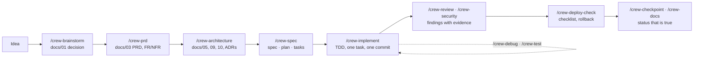

# anycrew

**One crew of specialist AI agents for any coding assistant.**
Spec-driven, test-first, security-reviewed, and model-tiered so cheap work goes to cheap models.

anycrew installs a ready-made engineering team into Claude Code, OpenAI Codex, Google Antigravity,
Cursor, OpenCode and GitHub Copilot: a brainstormer, a product manager, an architect, a designer, a
spec writer, an implementer, a tester, a reviewer, a security reviewer, a debugger, an AI engineer,
a release engineer, a doc writer, a scout and a crew lead. They follow one method, from idea to a
deployed MVP, and leave behind the documents a team can actually review: a constitution, a PRD,
ADRs, specs with acceptance criteria, an implementation-status page that says what is really built.

> Status: **0.1.0, early**. The pack, the CLI and the generated layouts work end to end (see
> `npm test`). Formats for each assistant were verified against their docs on 2026-10-29; the ones
> marked *best effort* in [docs/04-tool-matrix.md](docs/04-tool-matrix.md) have not yet been
> exercised in that assistant. Feedback and PRs welcome.

## Why

Every new project repeats the same setup: an agent guide, rules, a handful of slash commands, a
constitution, a docs skeleton, a spec/plan/tasks loop, quality gates. And every assistant wants it
in a different folder with a different front matter. The existing packs are either tied to one
assistant, skills-only without a team, or a method without the security, testing, docs and deploy
roles an MVP needs. None of them says *which model each role needs*.

anycrew is the boilerplate for the **team**, not for the stack. It is boilerplate-agnostic: a
preset describes your stack's commands and conventions; anycrew never forces a framework.

## What you get

| | |
|---|---|
| **16 agents** | each with a job, inputs, outputs, a procedure, rules and a **model tier** (`fast`, `balanced`, `strong`) |
| **22 skills** (`/crew-*`) | the workflow as slash commands: status, brainstorm, research, prd, architecture, adr, design, spec, plan, tasks, implement, test, review, security, verify, debug, checkpoint, deploy-check, docs, llm, sync, init |
| **6 rules** | spec-driven process, architecture boundaries, security and data, LLM features, testing, docs and status; plus stack rules generated from your preset |
| **Docs skeleton** | constitution, brainstorm, research, PRD, traceability, architecture, data model, API, frontend, design system, conventions, security, testing, infra, observability, delivery plan, implementation status, ADRs, specs |
| **Presets** | `python-fastapi-react`, `node-typescript-next`, `go-service`, `generic`; write your own in one JSON file |
| **Hooks** | a tool-agnostic lint-after-edit hook wired into each assistant |
| **One CLI** | `npx anycrew init` generates every assistant's native files from one source; `sync` keeps them current without touching your edits |

## Quick start

```bash
cd your-project
npx anycrew init --preset python-fastapi-react --tools claude,codex,antigravity
# or: npx anycrew init            (detects the assistants on your machine)
npx anycrew doctor                # what each assistant will read
npx anycrew list                  # agents, tiers and the model each tool will use
```

Then open your assistant in the folder and type `/crew-status`. For a new idea, `/crew-brainstorm`;
for an existing codebase, `/crew-spec`.

Install the pack globally instead of per project:

```bash
# Claude Code
claude plugin marketplace add fadlytanjung/anycrew && claude plugin install anycrew@anycrew
# Antigravity
agy plugin install https://github.com/fadlytanjung/anycrew
# Codex / Copilot CLI (Agent Plugins manifest)
codex plugin marketplace add fadlytanjung/anycrew
copilot plugin install fadlytanjung/anycrew
# Skills only, any assistant
npx skills add fadlytanjung/anycrew
```

## How it works



Each skill delegates to one agent at its tier. The crew lead sequences phases and keeps a person at
every gate: the decision, the P0 scope, the ADRs, the spec, the deploy.

| Tier | Claude Code | Antigravity | Codex | OpenCode | Used for |
|---|---|---|---|---|---|
| fast | haiku / low effort | flash | low effort | claude-haiku | scout, doc-writer |
| balanced | sonnet / medium | flash | medium | claude-sonnet | implementer, tester, researcher, designer, release-engineer |
| strong | opus / high | pro | high | claude-opus | brainstormer, product-manager, architect, spec-writer, reviewer, security-reviewer, debugger, ai-engineer, crew-lead |

Override any cell per project in `.anycrew/config.json` → `models`. Cursor and Copilot default to
`inherit` until you set model IDs. Details: [docs/03-model-tiers.md](docs/03-model-tiers.md).

## What `init` writes

```
your-project/
├── AGENTS.md                 agent guide, read by every assistant (yours to edit)
├── CLAUDE.md                 @AGENTS.md
├── docs/                     constitution, status, specs index, ADR + spec templates (yours)
├── .anycrew/config.json      preset, tools, model overrides
├── .anycrew/hooks/           lint-after-edit.sh
├── .agents/rules|skills|agents   universal layer: Codex, Antigravity, Cursor, Copilot, OpenCode
├── .claude/agents|skills|rules + settings.json hooks
├── .codex/agents/*.toml
├── .cursor/rules/*.mdc, agents/, hooks.json
├── .opencode/agents/
└── .github/copilot-instructions.md, instructions/, agents/, hooks/
```

Generated files carry an `anycrew:generated` marker; `sync` rewrites only those and reports the
rest. `AGENTS.md` and everything under `docs/` are created once and then belong to you.

## Documentation

- [docs/00-vision.md](docs/00-vision.md): what anycrew is and is not, principles
- [docs/01-method.md](docs/01-method.md): the lifecycle, artifacts, gates, who does what
- [docs/02-agents.md](docs/02-agents.md): the roster, how to customise or add an agent
- [docs/03-model-tiers.md](docs/03-model-tiers.md): tiers and the mapping per assistant
- [docs/04-tool-matrix.md](docs/04-tool-matrix.md): what each assistant reads, how to install, verification status
- [docs/05-landscape.md](docs/05-landscape.md): how anycrew compares with BMAD, superpowers, spec-kit, wshobson/agents and others
- [docs/06-project-layout.md](docs/06-project-layout.md): the docs skeleton and the spec loop in detail
- [docs/07-presets.md](docs/07-presets.md): stack presets and writing your own
- [docs/08-roadmap.md](docs/08-roadmap.md): what is next
- [docs/adr/](docs/adr/): why the canonical format, tiers and JSON config look the way they do

## Contributing

`npm test` validates the pack (front matter, tier consistency, Agent Skills spec fields, size
budgets) and runs the smoke test (init for every preset and tool, idempotent sync, protection of
hand-written files). See [CONTRIBUTING.md](CONTRIBUTING.md).

## Licence

MIT.
