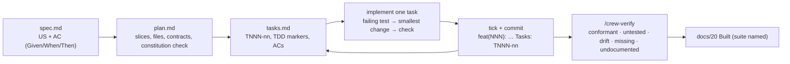

# 01 — Method

anycrew's method is spec-driven development with a human at every gate. It was distilled from
several shipped products built this way and generalised; the templates in `templates/docs/` are the
documents those products kept.

## Phases, artifacts, gates

| Phase | Skill | Agent (tier) | Artifact | Gate before the next phase |
|---|---|---|---|---|
| Setup | `/crew-init` | crew-lead | `AGENTS.md`, `docs/00`, `docs/20`, rules, hooks | check command runs |
| Discover | `/crew-brainstorm`, `/crew-research` | brainstormer (strong), researcher (balanced) | `docs/01`, `docs/02` | a person approves the decision |
| Define | `/crew-prd` | product-manager (strong) | `docs/03`, `docs/04` | P0 fits the deadline; IDs exist |
| Design | `/crew-architecture`, `/crew-adr`, `/crew-design`, `/crew-llm` | architect, designer, ai-engineer | `docs/05`, `09`, `10`, `11`, `12`, `06`, ADRs, `contracts/` | constitution check; ADRs approved |
| Specify | `/crew-spec`, `/crew-plan`, `/crew-tasks` | spec-writer (strong) | `docs/specs/NNN-*/{spec,plan,tasks}.md` | every AC testable; tasks small and ordered |
| Build | `/crew-implement`, `/crew-test`, `/crew-debug` | implementer, tester (balanced), debugger (strong) | code, tests, ticked tasks | check command green; one task, one commit |
| Verify | `/crew-review`, `/crew-security`, `/crew-verify` | reviewer, security-reviewer (strong) | findings, conformance table, `docs/14` | no Critical open; drift decided by a person |
| Ship | `/crew-deploy-check` | release-engineer (balanced) | `docs/16`, `docs/17`, checklist | checklist complete; rollback known; person approves prod |
| Record | `/crew-checkpoint`, `/crew-docs` | doc-writer (fast) | `docs/20`, README, changelog | status matches the tree |

`/crew-status` (scout, fast) tells you which phase you are in and the next task at any time.

## The spec loop

## IDs that tie everything together

| ID | Meaning | Where it appears |
|---|---|---|
| `FR-NNN`, `NFR-NNN` | requirement | PRD, traceability, spec header |
| `US-NNN-n` | user story n of spec NNN | spec.md |
| `AC-NNN-n` | acceptance criterion | spec.md, test names, commit trailer |
| `TNNN-nn` | task | tasks.md, commit trailer |
| `ADR-NNN` | decision | docs/adr, linked from specs |

## The gates are for people

Agents never approve their own work. A gate is a short question to the person: "this is the
decision, yes or no", "this is P0, is the cut line right", "these ADRs, accept", "this spec is
Ready", "deploy to production". Inside a phase the agents do not ask for permission.

## Definition of done for a task

- The ACs the task names are demonstrably met (test or documented manual check).
- The check command is green.
- No new dependency without a note in the spec's plan.
- Docs updated if behaviour, contracts or status changed.
