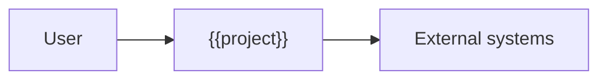
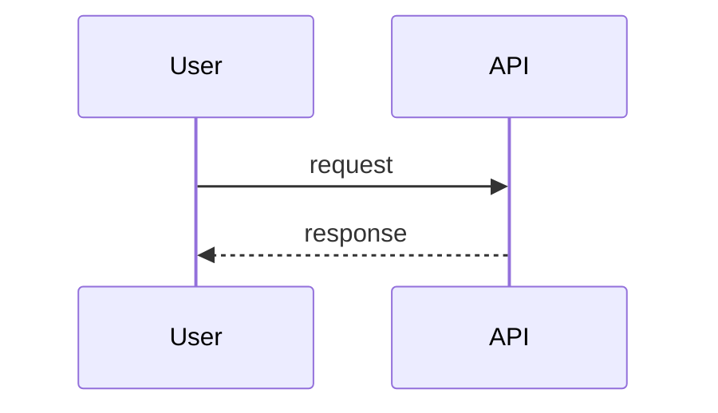

# 05 — Architecture

> Containers, flows and boundaries. Decisions that are expensive to reverse are in [`adr/`](adr/README.md).

## 1. Context

## 2. Containers
| Container | Responsibility | Runs where | Talks to |
|---|---|---|---|
## 3. Critical flows

## 4. Boundaries and layers
| Layer | May import | Must not |
|---|---|---|
## 5. State, jobs and idempotency
## 6. Limits and quotas
| Limit | Value | Enforced where |
|---|---|---|
## 7. Regions, residency and environments
## 8. Constitution check
| Principle | How the design satisfies it |
|---|---|
## 9. Specs to write, in build order
| # | Spec | Depends on |
|---|---|---|
