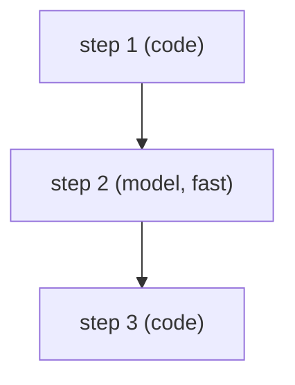

# 06 — Agent design

> The model-backed parts of the product: where a model is used, where code decides, every call's
> contract, guardrails and evals. Rule: `.agents/rules/50-llm-features.md`.

## 1. Model / code boundary
| Step | Needs | Done by | Why |
|---|---|---|---|
| | judgement / correctness | model (tier) / code | |
## 2. Calls
| Call | Purpose | Inputs (untrusted marked) | Output schema | Tier | Temp | Timeout / retry / fallback | Cost per call |
|---|---|---|---|---|---|---|---|
## 3. Prompts
Prompts live in `{{prompts_dir}}` with front matter `id`, `version`, `model`, `output_schema`.
## 4. Guardrails
- Untrusted content framing; tool permissions; output validation; grounding and citations.
## 5. Orchestration (if multi-agent)

## 6. Evals
| Eval | Dataset | Scorer | Last result (date) |
|---|---|---|---|
## 7. Tracing and cost
