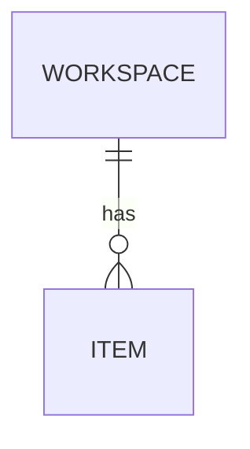

# 09 — Data model

## 1. Entities
| Entity | Owner / tenancy | ID scheme | Lifecycle states |
|---|---|---|---|
## 2. Diagram

## 3. State machines
| Entity | From | Event | To | Side effects |
|---|---|---|---|---|
## 4. Indexes and queries
## 5. Versioning and migrations
Every stored record carries a schema version; breaking changes go expand → migrate → contract.
## 6. Retention and deletion
