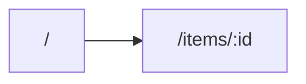

# 11 — Frontend

## 1. Information architecture
## 2. Routes
| Path | Purpose | Data | Who can see it |
|---|---|---|---|
## 3. Screen flow

## 4. Screens
### <screen>
- **Words:** title, labels, actions.
- **States:** loading, empty, error, success.
- **Responsive:** 360–599 / 600–1023 / 1024–1600 px behaviour.
## 5. Realtime and caching
## 6. Accessibility
