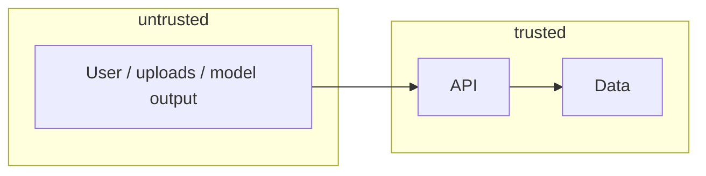

# 14 — Security

## 1. Assets and actors
## 2. Trust boundaries

## 3. Controls
| ID | Boundary | Control | Proven by (test) |
|---|---|---|---|
| C1 | | | |
## 4. Data protection
## 5. Dependencies and supply chain
## 6. Residual risks
| Risk | Accepted by | Date | Revisit |
|---|---|---|---|
