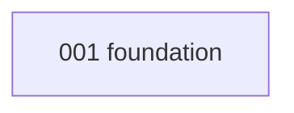

# Specs

Each folder is one feature, written spec-first: **`spec.md`** (what and why, with acceptance
criteria) → **`plan.md`** (how, which files) → **`tasks.md`** (ordered, test-first checklist).

## Index and build order

| # | Spec | Priority | Depends on | Status |
|---|---|---|---|---|

## How a coding agent works a spec

1. Read `AGENTS.md`, then the spec's `spec.md`, `plan.md` and every doc they link.
2. Take the first unchecked task in `tasks.md`. For **TDD** tasks, write the failing test first.
3. Implement the smallest change that makes it pass; run `{{check_cmd}}`.
4. Tick the task, commit `feat(NNN): …` with `Tasks: TNNN-nn` in the body.
5. If the spec is wrong or unclear, stop and propose a spec change. Do not silently diverge.
6. When the spec's tasks are done, update `docs/20-implementation-status.md`.

The `/crew-spec`, `/crew-implement` and `/crew-verify` skills encode this loop.
